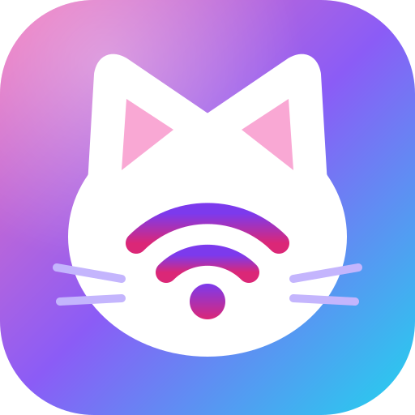
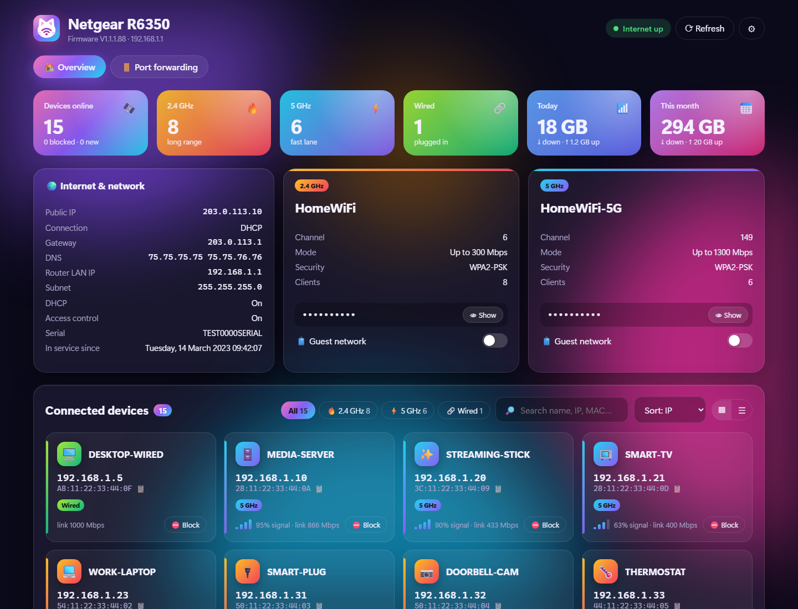

<p align="center"></p>

# PurrRouter: a modern dashboard for Netgear routers (R6350)

**PurrRouter** is a colorful, modern replacement for the Netgear router admin page (routerlogin.net / 192.168.1.1).
It runs locally on your PC and shows everything at a glance: **connected devices** with IP and MAC addresses,
2.4 GHz / 5 GHz / wired bands, Wi-Fi signal, traffic usage, and **port forwarding**. You can block or allow
devices with one click.

Built and tested on the **Netgear R6350**, firmware V1.1.1.88. The device list, block/allow and Wi-Fi info use
Netgear's SOAP API (the same one Home Assistant's Netgear integration uses via pynetgear), so other Netgear models
may work too, but only the R6350 has been tested. According to
[OpenWrt](https://openwrt.org/toh/netgear/r6350), the **R6260** and **R6850** use the same factory firmware image as the
R6350, so they're the most likely to work fully. Reports welcome! Port forwarding and band detection read the router's own web
pages, which are more likely to differ between models.



## Features
- 📱 **Connected devices**: name, IP, MAC (one-click copy), band (2.4 GHz / 5 GHz / wired), signal %, link rate
- 🏷️ Your own **labels** for "UNKNOWN" devices, plus a **NEW** badge when an unfamiliar device joins
- ⛔ **Block / allow** devices (Netgear Access Control)
- 🚪 **Port forwarding**: list, add, edit, delete rules, picking the target from your devices
- 🧺 **DHCP address reservations** (LAN Setup): list, add, edit, delete; pick the device, see who's using each address
- 📶 **Wi-Fi settings** (Wireless Setup): network name, password, channel and name broadcast for each band
- 📜 **Logs & status**: the router's log with device names filled in, uptime, per-port traffic, internet lease info
- 🐾 Very cat-themed (click the logo)
- 📶 Both Wi-Fi bands: SSID, channel, mode, show/copy the Wi-Fi password, guest network on/off
- 🌍 Internet status, public IP, DNS, gateway; traffic meter (today / this month)
- ⏱️ Adjustable auto-refresh; ⏻ reboot button

## Run it
Requires the [.NET 10 SDK](https://dotnet.microsoft.com/download).

```
dotnet run -c Release
```

Or double-click **`run.cmd`** on Windows. Your browser opens to http://localhost:5280. Enter your router's admin
password once.

**Single .exe:** run **`publish.cmd`** to get `publish\PurrRouter.exe` (self-contained, no .NET install needed).

## Privacy & security
- Listens on **localhost only**; nothing else on your network can reach it.
- The router password is stored in `%LOCALAPPDATA%\PurrRouter\state.json`, encrypted with Windows DPAPI.
- Write requests require a custom header, which blocks other websites from poking the local API.

## How it talks to the router
| Feature | How |
|---|---|
| Device list, block/allow, Wi-Fi info, guest network, traffic, reboot | Netgear SOAP API (`/soap/server_sa/`) |
| 2.4 / 5 GHz band per device | Router's Attached Devices page (`DEV_devices.htm`) |
| Port forwarding | Router's `FW_forward.htm` / `FW_forward_service.htm` forms |

R6350 firmware quirks handled: `GetAttachDevice2` drops the connection (falls back to `GetAttachDevice`), and the
block/allow reply contains an invalid header line (`BLOCK 44`), so PurrRouter uses a forgiving built-in HTTP client.

## Developing without a router
`tools/mock-router/mock_router.py` is a fake R6350 (SOAP + web pages, with the same quirks):

```
python tools/mock-router/mock_router.py --r6350
```

Then sign in to address `127.0.0.1`, port `8099` (under Advanced), password `test`.

Diagnostics: http://localhost:5280/api/diag shows the last 200 router requests (passwords and cookies are never logged).

## Keywords
Netgear R6350 dashboard · Netgear R6260 · Netgear R6850 · Netgear router admin alternative · Netgear attached devices · Netgear SOAP API ·
Netgear port forwarding tool · home network monitor · .NET 10 · ASP.NET Core
